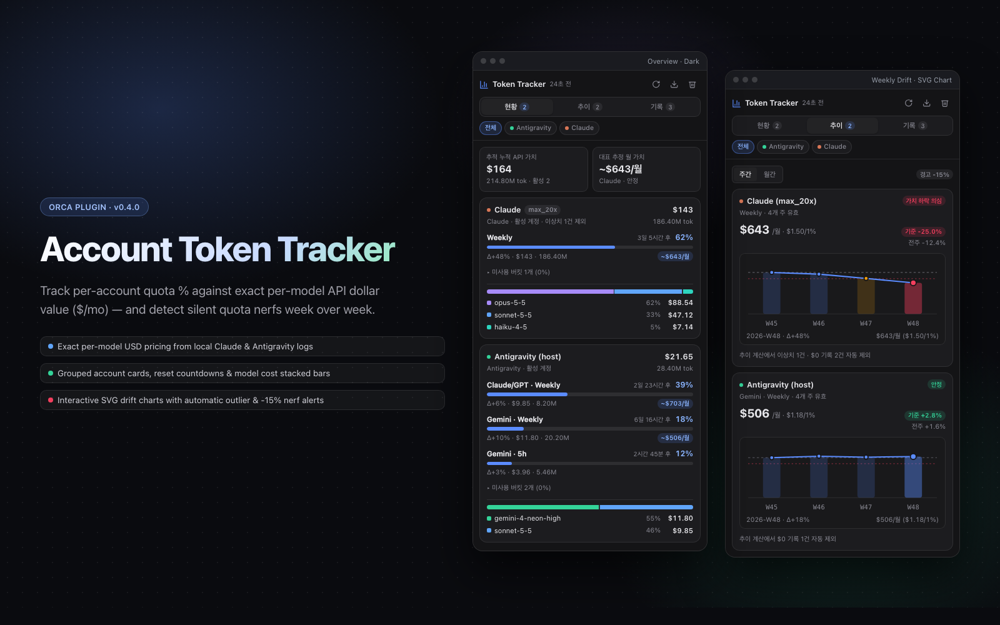
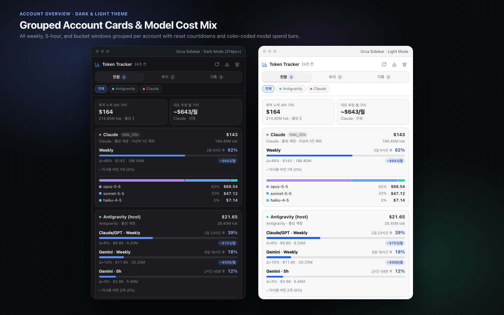
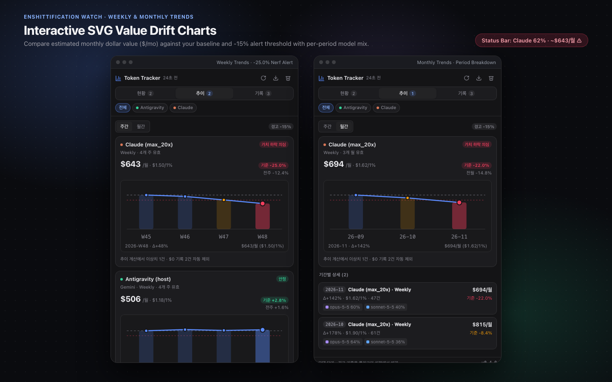
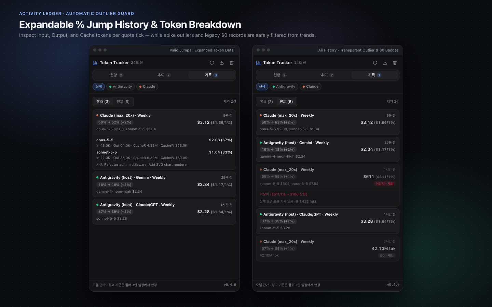

# Account Token Tracker



An [Orca](https://onorca.dev) sidebar plugin that tracks **per-account quota percentage (`%`) vs. exact per-model API dollar value (`$/1%` & `$/mo`)**, visualizes your model spend mix, and monitors **weekly & monthly value trends** to catch silent quota nerfs (*enshittification*) early.

계정별 쿼터 사용률(`%`) 변화와 **모델별 API 단가 기준 환산 가치(`$/1%` · 추정 `$/월`)**를 실시간 추적하고, **주간/월간 추이 차트**로 구독 쿼터의 실질 가치 하락(enshittification)을 감시하는 Orca 플러그인입니다.

---

## Why `$/mo` instead of raw tokens?

Raw token counts fluctuate wildly depending on whether you run Opus vs. Sonnet vs. Haiku, or prompt-cache reads vs. output tokens. By weighting every turn's `input`, `output`, `cache_write (5m / 1h)`, and `cache_read` tokens at public API rates, **Account Token Tracker** normalizes usage into **API dollar value per 1% of quota (`$/1%`)** and **estimated 30-day subscription value (`$/mo`)** — making silent quota shrinkage immediately visible.

---

## Screenshots

### Account Overview & Model Cost Mix (Dark & Light)


- **Account-Grouped Cards**: Combines Weekly, 5-hour, and model-bucket quotas under one card per account with live reset countdowns and automatic collapsing of unused `0%` buckets.
- **Model Cost Stacked Bar**: See at a glance which models drive your spend, with hover tooltips for exact `Input / Output / Cache Read / Cache Write` totals.

### Weekly & Monthly Value Drift (Enshittification Watch)


- **Interactive SVG Trend Charts**: Compares each week or month's estimated `$/mo` value against your baseline reference line and `-15%` alert threshold.
- **Per-Period Model Mix**: Inspect model share chips per period to verify whether a shift came from your own model mix or a quota nerf.
- **Status Bar Telemetry**: Live status bar summary (`Claude 62% · ~$643/월 ⚠`) with tone alerts when usage is high or value drops.

### Expandable `%` Jump Ledger & Automatic Outlier Guard


- **Click-to-Expand Token Breakdown**: Review exact per-model tokens and linked sessions for every `+1%` quota tick.
- **Automatic Outlier & Legacy `$0` Filtering**: Preserves all raw history while automatically excluding `$0` legacy/external records and anomalous backfill spikes (`>$100/1%` or `>5×` series median) from trend math.
- **One-Click CSV Export**: Export either the raw `%` jump ledger or weekly/monthly trend rollups.

---

## Supported Agents & Data Sources

| Provider | Usage Source | Precision |
| --- | --- | --- |
| **Claude Code** | Incremental byte-offset tail of `~/.claude/projects/*/*.jsonl` (cross-poll `message.id` deduplication) | Exact per-model `in / out / cache_5m / cache_1h / cache_read` |
| **Antigravity CLI** | Incremental tail of `~/.gemini/antigravity-cli/brain/*/…/transcript.jsonl` with bucket-aware model routing | Exact per-model `in / out / cache_read` |
| **Codex, Gemini, Cursor, OpenCode Go, Kimi, Grok, MiniMax, ZCode, Muse** | Orca `agent.listSessions` (`history:read`) | Blended provider API estimate (customizable via `customPricingJson`) |

---

## Installation

Install directly from Orca:

```bash
orca plugin install tksuns12/account-token-tracker --json
```

Or browse the community listing at:
`https://www.onorca.dev/plugins/tksuns12/account-token-tracker`

---

## Settings

| Key | Default | Description |
| --- | --- | --- |
| `pollIntervalSec` | `60` | Sampling interval in seconds (`15`–`3600`). Also refreshes automatically when an agent finishes a turn. |
| `maxLedgerEntries` | `300` | Maximum raw `%`-jump entries retained (`50`–`2000`). Weekly/monthly rollups are kept permanently. |
| `nerfAlertDropPercent` | `15` | Percentage drop from baseline `$/mo` that triggers a value-drop warning (`5`–`80`). |
| `customPricingJson` | `""` | Optional JSON overrides in USD per 1M tokens, e.g. `{"claude-opus-5-5":{"input":5,"output":25}}`. |

---

## Requested Capabilities & Privacy

All processing happens **100% locally** on your machine. No conversation content or telemetry is ever uploaded.

| Capability | Why it is needed |
| --- | --- |
| `storage:own` | Persists quota baselines, `%` jump ledger, incremental file offsets, and permanent weekly/monthly rollups locally. |
| `settings:own` | Reads user settings (`pollIntervalSec`, `maxLedgerEntries`, `nerfAlertDropPercent`, `customPricingJson`). |
| `history:read` | Calls `agent.listSessions` for agents without local JSONL logs (metadata & token counts only, never conversation content). |
| `agent:read` | Subscribes to `agent.status.changed` to capture a snapshot right after an agent completes a turn. |

---

## Development

```bash
orca plugin validate . --json
orca plugin test . --json
orca plugin check . --json
orca plugin dev load . --json
```

## License

MIT
